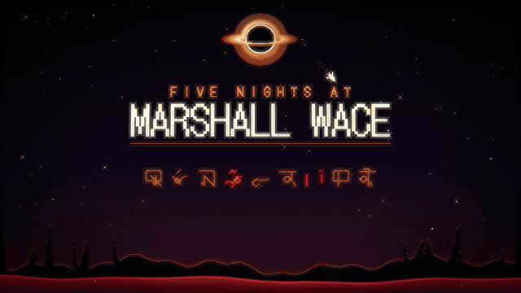
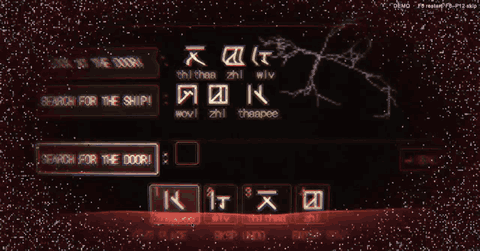
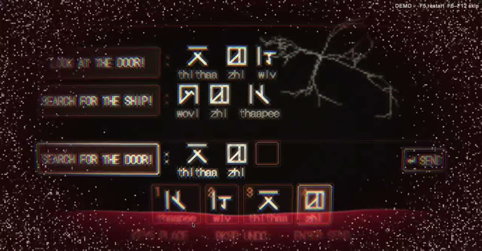
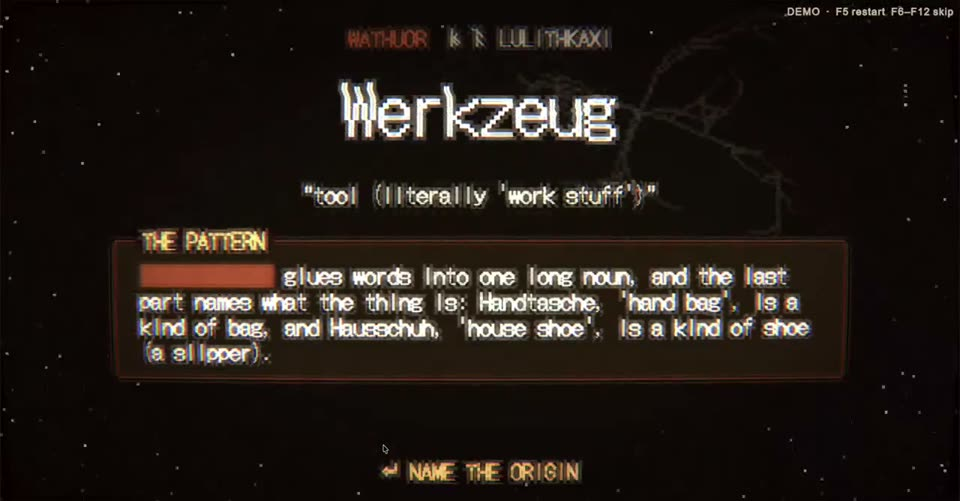
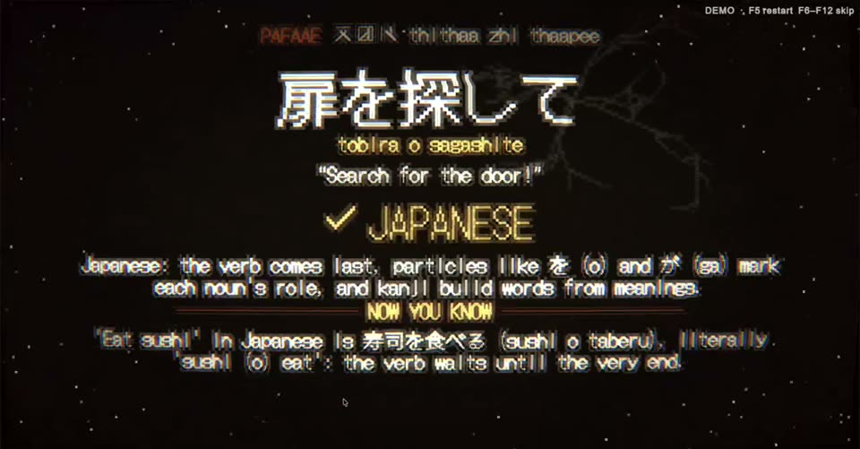
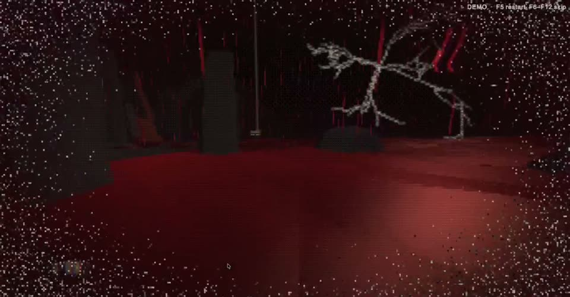
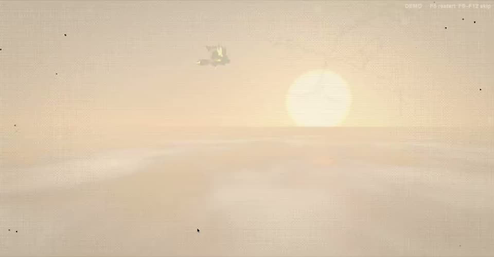
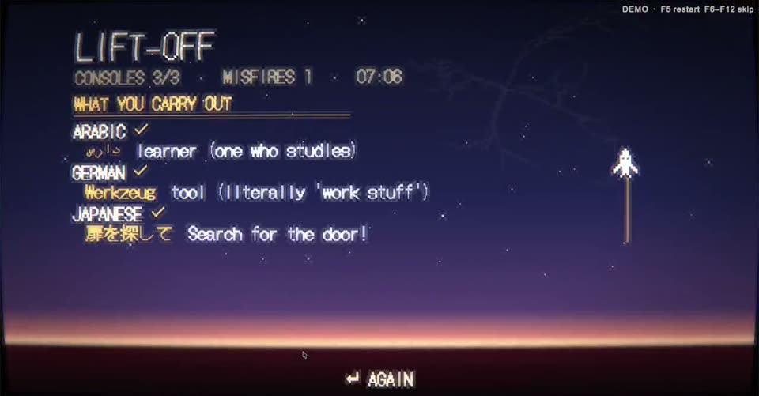

<div align="center">



# Five Nights at Marshall Wace

**A language-learning horror game for desktop and Meta Quest 2.**

Crack real Earth languages hidden in an alien script, restart your ship,<br>
and get off a blood-sea planet before the thing in the fog works out how you think.

[The idea](#the-idea) · [How a run plays](#how-a-run-plays) · [Languages](#seven-real-languages) · [The beast](#the-beast) · [Run it](#run-it) · [Repository](#whats-in-the-repository) · [License](#license)

</div>

---

## The idea

Most language apps teach by flashcard. Field linguists learn a language differently: they look at a handful of real sentences, compare them, and work out the rules themselves. This game turns that process into a survival horror.

You crash through a wormhole onto TrES-2b, a planet of red fog and a sea of blood. Your ship needs power, and the only way to get it is to talk to three alien consoles on the shore. Each console speaks a **real Earth language** (Japanese, Mandarin, Arabic, German, French, Spanish or Turkish) written in a procedurally drawn alien script. You get two or three example phrases with their meanings, and from those alone you work out the grammar and build the answer from word tiles.

Get it right and the alien glyphs decode into the real script in front of you: 扉を探して, دارس, Werkzeug. The game shows you the pattern you just used, asks you which language it was, and tells you something true about it. Get it wrong and the glass cracks, the ship hints at the rule you broke, and the beast lunges.

The words are real, the grammar is real, and every puzzle is checked by brute force to have exactly one answer a reasoning player could justify. You leave the planet having actually learned how three languages work.

<div align="center">

<br>
<sub>Building <i>tobira o sagashite</i> ("search for the door") at a Japanese console, the reveal, and the escape.</sub>
</div>

## How a run plays

1. **Transit.** A wormhole intro drops you on the shore. A short tutorial (replayable with T, skippable by holding Q) teaches movement, the lamp and the consoles, and a worked example shows how to read a puzzle.
2. **Explore.** Walk the shore in the fog with a lamp. Three consoles glow green. Something is out there, and it freezes when you look at it.
3. **Decode.** At a console, compare the example rows, place glyph tiles in order and submit. A wrong answer earns a hint that names the rule, never the answer.
4. **Reveal and quiz.** The script decodes into the real language, the pattern is explained with the language's name blacked out, and you guess which language it was before it is stamped on.
5. **Escape or die.** With all three consoles restored the beast makes its final chase. Reach the ship and you lift off through the clouds to a debrief of everything you carry out. Get caught and you get the death ending.

<table>
  <tr>
    <td width="33%"><br><sub><b>The console.</b> Example rows above, glyph tiles below.</sub></td>
    <td width="33%"><br><sub><b>The reveal.</b> Werkzeug, literally "work stuff", is a tool.</sub></td>
    <td width="33%"><br><sub><b>The payoff.</b> The language is named, with a fact to keep.</sub></td>
  </tr>
  <tr>
    <td width="33%"><br><sub><b>The shore.</b> Red fog, dead trees, and something watching.</sub></td>
    <td width="33%"><br><sub><b>Lift-off.</b> Out through the clouds.</sub></td>
    <td width="33%"><br><sub><b>What you carry out.</b> Every phrase you built, and your time.</sub></td>
  </tr>
</table>

## Seven real languages

Each run picks languages from a seed and generates its puzzles from word tables, so no two runs are the same. Between them the languages have 22 puzzle types across four difficulty tiers.

| Language | What the puzzles teach | From the game |
|---|---|---|
| Japanese | Verb-last order, the particles が and を, kanji compounds | 電話 *denwa*, "electric talk": telephone |
| German | Nouns glued into compounds where the last part names the thing; verb-final clauses after *weil* | *Handschuh*, "hand shoe": glove |
| Arabic | Three-consonant roots carry the meaning, vowel patterns carry the role | k-t-b: *kataba* "he wrote", *kātib* "writer" |
| Turkish | Suffixes in a fixed order, with vowel harmony | *köylerimde*, "in my villages" |
| Mandarin | Measure words between a number and a noun, chosen by kind | 三只狼 *sān zhī láng*, "three wolves" |
| French | Adjectives after the noun, gender agreement, silent written plurals | *les murs verts* |
| Spanish | The verb ending carries the subject; ¿ opens a question | *¿Aprende?*, "does she learn?" |

Before a puzzle is used, the engine lists the "rival grammars" a player might wrongly assume (English word order, the wrong suffix order, head-first compounds), keeps the ones the examples cannot rule out, and tries every ordering of every subset of the tiles. If more than one answer could be justified, the puzzle is thrown away and rebuilt. The full answer sheet and the reasoning behind it are in [docs/PITCH.md](docs/PITCH.md), and [docs/answer-key](docs/answer-key/README.md) prints the answers for any seed.

## The beast

The Principal is not scripted to a timer. It runs a small online Bayesian model of you: a logistic regression that updates after every answer and estimates your skill on each grammar concept, with uncertainty. It uses that model to pick each console's difficulty, aiming for about a 70 percent chance that you succeed, and it grows bolder when you are weak or on a losing streak.

- It lurks in the fog, stalks behind you, freezes while you look at it, creeps closer while you work a console, lunges on a wrong answer and backs off on a right one.
- It evolves through three stages over time and with each mistake, and can only catch you at the last one.
- It remembers you between runs. Press F3 to see what it has learned about you.

Everything you hear is synthesised in C# at runtime: an 11-layer generative score that moves between dread, tension and panic with the beast's distance, a melody built from the phrase you just solved, and the beast's voice placed in 3D. There are no audio files in the game.

## Run it

### Desktop

1. Install **Unity 6000.6.9f1** and open the `Unity/` folder.
2. Open `Assets/Scenes/Main.unity` and press Play. Everything is spawned from code, so there is nothing to edit in the scene.

| Action | Keys |
|---|---|
| Start | Enter or Space |
| Move, look, run | WASD, mouse, Shift |
| Lamp | F |
| Use a console / leave it | E / Esc or Tab |
| Place tiles, undo, clear, submit | Number keys or arrows and Space, Backspace, Delete, Enter |
| Ask the ship for a hint | H |
| Demo mode (fixed seed 4242, forgiving beast) | F1, or the `-demo` launch flag |

Developer keys F5 to F12 restart and skip between phases. The full desktop and Touch tables are in [Unity/Docs/oculus/SETUP.md](Unity/Docs/oculus/SETUP.md#5-controls-touch), and [Unity/README.md](Unity/README.md) covers driving the Editor from the command line.

### Meta Quest 2

Install Android Build Support, enable developer mode on the headset, then in the Editor run **Fnmw > Quest > Configure project for Quest** and **Fnmw > Quest > Build APK**. With the headset connected:

```bash
adb install -r Unity/Builds/Quest/FiveNightsAtMarshallWace-Quest.apk
```

The setup guide, signing variables and batch-mode build command are in [Unity/Docs/oculus/SETUP.md](Unity/Docs/oculus/SETUP.md).

### Optional services

The game plays fully offline. Two optional services add to it:

- **Voice server** ([backend/](backend/README.md)). OpenRouter writes the beast's taunts and the ship's hints from what is happening in the run, and ElevenLabs speaks them and pronounces the decoded sentence. It has a keyless mock mode: `cd backend && npm install && npm run dev`.
- **QS telemetry** ([qs-backend/](qs-backend/README.md)). With the player's consent, the headset streams head, hand and breathing data to a FastAPI service on Vercel backed by Supabase. It turns that into one record per question and a plain-language summary for a live employer page at `/qs/`. It is off by default.

## What's in the repository

| Path | What it is |
|---|---|
| [`Unity/`](Unity/README.md) | The game. Unity 6000.6.9f1 with URP, built code-first from one `GameBootstrap` object. Scripts are split into Core, Game, Lang, Monster, UI, Audio, World, Voice and XR, with EditMode tests. |
| [`backend/`](backend/README.md) | Voice server in Node and TypeScript with no runtime dependencies. |
| [`qs-backend/`](qs-backend/README.md) | QS telemetry service: FastAPI on Vercel, Postgres and Realtime on Supabase, migrations in `supabase/migrations/`. |
| `src/`, `qs/`, `index.html` | Vite site. `/qs/` is the employer page; `/` is the early Three.js prototype from the first hours of the hackathon. |
| [`assets/`](assets/README.md), `tools/blender/` | Procedural Blender kit that builds the game's 15 low-poly models, including the beast. |
| [`docs/`](docs/PITCH.md) | Pitch notes and answer sheet, the answer-key tool, sponsor integration research and the security review. |

```
Unity game ──▶ backend/ (voice) ──▶ OpenRouter (text), ElevenLabs (speech)
     │
     └──(opt-in)──▶ qs-backend/ (Vercel) ──▶ Supabase Postgres + Realtime ──▶ /qs/ employer page
```

<details>
<summary><b>Running the services and tests locally</b></summary>

<br>

**Voice server** (Node 22.18+):

```bash
cd backend
npm install
cp .env.example .env   # set FNMW_GAME_TOKENS before starting
npm run dev            # mock mode on http://127.0.0.1:8787, no provider keys needed
```

Point the game at it with `Unity/UserSettings/fnmw-voice.json` holding `url` and `token`. Details and every variable are in [backend/README.md](backend/README.md).

**QS backend** (Python 3.12+ and uv):

```bash
cd qs-backend
uv sync
QS_STORE=memory SUPABASE_JWT_SECRET=<long dev secret> uv run uvicorn main:app --reload
```

Provisioning Supabase and deploying to Vercel are covered in [qs-backend/README.md](qs-backend/README.md); the game-side sender is in [Unity/Docs/qs/README.md](Unity/Docs/qs/README.md).

**Vite site:**

```bash
npm install
npm run dev
```

**Tests:**

| Part | Command |
|---|---|
| Unity (EditMode) | Window > General > Test Runner, or from `Unity/` with the Editor closed: `~/.unity/bin/unity test "$PWD" --mode EditMode -o /tmp/test-results.xml` |
| Unity compile check | `python3 Unity/Tools/cc.py` |
| Voice server | `cd backend && npm test && npm run typecheck` |
| QS backend | `cd qs-backend && uv run pytest` |
| Vite site | `npm test && npm run build` |

</details>

## Secrets

The repository is public and nothing secret is committed. `.env` files, `Unity/secrets.json`, `Unity/UserSettings/`, `Unity/Assets/Resources/Ai/` and `Unity/Assets/Resources/Qs/` are git-ignored, and each `*.example` file lists variable names only. A build guard fails any Unity build that would bundle a OpenRouter key.

## Status

- **Quest 2.** The port, visible Touch controllers and the VR tutorial are merged and covered by EditMode tests, and the APK builds. It has not yet been played on a real headset, so comfort, readability and the scare timing still need a pass in VR.
- **AI features.** Generated taunts, hints and the run debrief use OpenRouter free models with a zero-price routing cap. Without it the game falls back to server-written taunts, authored hints and a stock debrief, so a run never blocks on the network.
- **Voice server.** Runs as a single long-lived process and is not deployed. Standalone builds need it behind HTTPS.
- **QS employer page.** Deployed and reading live data from the demo employer. The employer names on it are placeholders.

## Credits

Built at a hackathon by the team listed on the [contributors page](https://github.com/jickzx/five-nights-at-marshall-wace/graphs/contributors).

## License

The code in this repository is released under the [MIT License](LICENSE).

The bundled fonts keep their own licenses: **DotGothic16** and **Unifont** are under the SIL Open Font License 1.1 (the full texts sit next to the fonts in `Unity/Assets/Resources/UI/Fonts/`, and DotGothic16's also in `public/qs/fonts/`). The Unity engine and its packages are not part of this repository and are covered by Unity's own terms. OpenRouter, ElevenLabs, Supabase and Vercel are used under their providers' terms.
