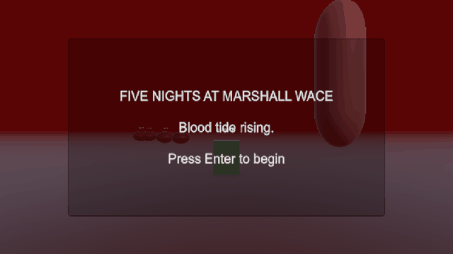

# Five Nights at Marshall Wace (Unity)

This is the Unity 6000.6.9f1 (URP) version of the blood-planet horror game. It's built code-first: `Assets/Scenes/Main.unity` holds a single `GameBootstrap` object, and the bootstrap spawns everything else at runtime. **Never edit the scene or a shared prefab.** Work only inside your own folder.



## Run it with the Unity CLI

All commands run from `Unity/`. The CLI lives at `~/.unity/bin/unity`. If more than one Editor is open, pin every command to this project with `--project-path "$PWD"`, or export `UNITY_PROJECT_PATH="$PWD"`.

```bash
# first time on a machine: accept the Editor terms, or the Editor hangs on a hidden modal
~/.unity/bin/unity terms accept 6000.6.9f1 --yes

# open the Editor and wait until the CLI can drive it
~/.unity/bin/unity open "$PWD" --until-ready --timeout 600

# compile (zero rows = zero errors/warnings)
~/.unity/bin/unity recompile --project-path "$PWD"

# EditMode tests, Editor closed (batch mode, writes NUnit XML)
~/.unity/bin/unity test "$PWD" --mode EditMode -o /tmp/test-results.xml
# EditMode tests, Editor open (`unity test` refuses while the project is open)
~/.unity/bin/unity command test run --project-path "$PWD" --mode editor

# play
~/.unity/bin/unity command script eval --project-path "$PWD" \
  --code 'UnityEditor.SceneManagement.EditorSceneManager.OpenScene("Assets/Scenes/Main.unity");'
~/.unity/bin/unity command editor.playmode set_run_in_background --project-path "$PWD"
~/.unity/bin/unity command editor.playmode start --project-path "$PWD"
~/.unity/bin/unity command script eval --project-path "$PWD" --code 'return Fnmw.Core.Services.State.Phase.ToString();'
~/.unity/bin/unity command console get --project-path "$PWD"
~/.unity/bin/unity command editor.playmode stop --project-path "$PWD"

# screenshot of the game view
~/.unity/bin/unity command capture game_view --project-path "$PWD" --output-path /tmp/shot.png --width 960 --height 540

# record: plays win + lose paths via script eval, captures frames, writes a GIF (needs python3 + Pillow)
UNITY_PROJECT_PATH="$PWD" Tools/record-loop.sh /tmp/fnmw-frames /tmp/fnmw-loop.gif

# rebuild Main.unity if it ever gets damaged (batch mode, Editor closed)
~/.unity/bin/unity run "$PWD" -- -executeMethod Fnmw.EditorTools.SceneSetup.CreateMainScene
```

Gotchas:
- If the Editor starts and `unity status` never shows it, run `sample <pid> 1`. If it is sitting in `SoftwareTermsWindow`, the terms haven't been accepted (see above).
- If the Editor opens in Safe Mode, there's a compile error, so the CLI can't connect. Close it with `unity close "$PWD" --force` and compile in batch mode with the `unity run ... -executeMethod` line above. Errors print to the log.
- The project uses the **Input System only** (`activeInputHandler: 1`). Use `UnityEngine.InputSystem` (`Keyboard.current`), not `Input.GetKey`. Reference `Unity.InputSystem` in your asmdef.

**Meta Quest 2 (VR):** see [Docs/oculus/SETUP.md](Docs/oculus/SETUP.md) for the install list, build steps and Touch controls. The VR code (`Assets/Scripts/XR`, `Fnmw.XR`) only turns on when an OpenXR runtime is running, i.e. in the Android/Quest build; the desktop build has no XR loader and plays unchanged. Other areas read VR input through `Fnmw.Core.XrBridge`, next to their keyboard reads.

Playing by hand: Enter starts the game. Use WASD and the mouse to move and look, and E at the green console. In a puzzle, the number keys add tiles, Backspace clears and Enter submits. H asks the ship for a hint (the legend offers it after a wrong answer). In the quiz, the number keys pick an answer; on the payoff, P plays the decoded sentence again when voice is available. F2 shows the voice status line.

### Optional voices (monster dialogue, ship hints, pronunciation)

`Assets/Scripts/Voice` (`Fnmw.Voice`) is optional. With no configuration it makes **no network request** and shows authored hints only. To try the whole pipeline without provider keys, run the mock backend (`cd backend && npm install && npm run dev`, see [backend/README.md](../backend/README.md)) and create `Unity/UserSettings/fnmw-voice.json` (git-ignored):

```json
{ "url": "http://127.0.0.1:8787", "token": "<same value as FNMW_GAME_TOKENS in backend/.env>" }
```

Mock audio is a beeping tone, not speech; subtitles, the hint line, the payoff cue and F2 all say MOCK. Launch flags: `-voiceUrl`, `-voiceToken`, `-voice off`, `-voiceVolume 0.8`, `-subtitles off`. Provider keys live only in `backend/.env`; nothing under `Unity/` holds a key, a provider host or a voice id.

## Architecture

```
GameBootstrap (scene)  ->  Services.ResetToFakes()
                       ->  LangModule.Install()     Services.Language = ...
                       ->  AudioModule.Install()    Services.Audio = ...
                       ->  UIModule.Install()       Services.UI = ...
                       ->  WorldModule.Install()    spawns level, consoles (Interactable)
                       ->  MonsterModule.Install()  Services.BeastBrain/Difficulty = ..., spawns beast
                       ->  GameModule.Install()     spawns player + GameDirector (phase machine)
                       ->  VoiceModule.Install()    Services.Voice = ... (optional; offline without config)
```

- **`Fnmw.Core`** (`Assets/Scripts/Core`) is the contract: `GameState`, `GameEvents` (static bus), the language data types and `ILanguageEngine`, `IDifficultyDirector`, `IBeastBrain`, `IAudioDirector`, `IGameUI`, `Services` (the locator), `ModelLoader` and `Interactable`.
- `Core/Fakes` has a trivial implementation of every interface, so the game runs end to end with any subset of real systems missing.
- Feature assemblies reference **Core only**, never each other. They talk through `Services` and `GameEvents`.
- `ModelLoader.Load(name)` tries `Resources/Models/<name>`, then `Resources/Models/Mock/<name>`, then falls back to a labelled primitive. The names are `player, beast_stage1..3, ship, console, rock_a, rock_b, ruin_pillar, ruin_arch, door_sealed, mural_slab, wreck_debris, terrain_shore`.

## Folder ownership

| Folder | Assembly | Owner | Install() does |
|---|---|---|---|
| `Assets/Scripts/Core` | `Fnmw.Core` | shared, changes need a callout (below) | – |
| `Assets/Scripts/Lang` | `Fnmw.Lang` | Lang thread | register `ILanguageEngine` |
| `Assets/Scripts/Monster` | `Fnmw.Monster` | Monster/AI thread | register `IBeastBrain` + `IDifficultyDirector`, spawn beast |
| `Assets/Scripts/World` | `Fnmw.World` | World/Art thread | build the level, consoles, ship, fog, lighting |
| `Assets/Scripts/Game` | `Fnmw.Game` | Game-loop thread | player controller, `GameDirector` phase machine |
| `Assets/Scripts/UI` | `Fnmw.UI` | UI thread | register `IGameUI` (puzzle, reveal, quiz, end screens, HUD) |
| `Assets/Scripts/Audio` | `Fnmw.Audio` | Audio thread | register `IAudioDirector` (intensity, stingers) |
| `Assets/Scripts/Voice` | `Fnmw.Voice` | Voice (sponsor features) | register `IVoiceDirector` (hints, monster lines, pronunciation via `backend/`) |
| `Assets/Scripts/XR` | `Fnmw.XR` | VR port | detect a headset, build the VR rig around the player (Quest only; no-op on desktop) |
| `Assets/Resources/Models` (+`Mock`) | – | Art | drop FBX files by name |
| `Assets/Tests/EditMode` | `Fnmw.Tests.EditMode` | everyone, add files, don't edit others' | – |
| `Assets/Scripts/Bootstrap`, `Assets/Scripts/Editor`, `Assets/Scenes`, `Packages`, `ProjectSettings` | – | scaffold owner | don't touch without asking |

Put assets your area needs (materials, audio clips, prefabs) inside your own folder, or under `Assets/Resources/<Area>/`.

## Rules

1. **Core changes must be called out in the PR description.** Use a heading `## Core changes` that lists every changed type or member. Prefer additive changes: new members, new events. Don't rename or remove anything another thread may already use.
2. Never edit `Main.unity` or any shared prefab. Spawn from code inside your `Install()`.
3. Keep your fakes working. If your system isn't ready, leave the fake registered.
4. Before you open a PR: `unity recompile` shows zero errors and the EditMode tests pass.
