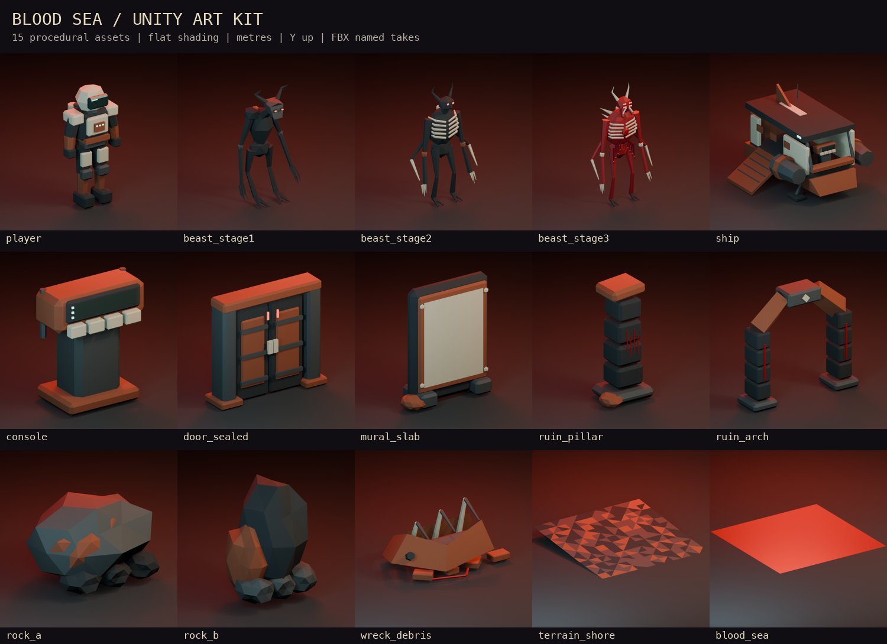

# Art review

The revised recordings show front, side and rear views together at natural animation speed. Each clip has a labelled pose sheet; every model has a three-angle silhouette sheet. The manifest records exact source ranges and recording timestamps.

| Recording | Clip start times (seconds) |
| --- | --- |
| [beast_stage1](beast_stage1.mp4) | 0.00 idle, 4.00 stalk, 7.00 chase, 7.75 lunge |
| [beast_stage2](beast_stage2.mp4) | 0.00 idle, 2.00 stalk, 4.00 chase, 6.00 lunge |
| [beast_stage3](beast_stage3.mp4) | 0.00 idle, 2.00 stalk, 4.00 chase, 6.00 lunge |
| [player](player.mp4) | 0.00 idle, 2.00 walk, 4.00 run, 6.00 death_martyr |
| [ship](ship.mp4) | 0.00 idle, 2.00 hatch_close, 4.00 takeoff |
| [door_sealed](door_sealed.mp4) | 0.00 open |

The beasts share a forked crown, wedge mask, long hooked fingers and a protruding spine. Stage 2 opens the rib cage and raises two secondary arms. Stage 3 exposes the torso cavity, splits the jaw, and adds collar eyes, torn skin and moving viscera. Stalk uses long planted steps; chase lowers the body into an asymmetric, snapping gait.

The player death descends to both knees, opens the arms and tips the head back, then holds. The ship takeoff pauses for ignition before lifting, retracting its landing feet, banking and accelerating. The camera follows its root so the ending remains visible.

| Model | Surface review | Animation pose sheets |
| --- | --- | --- |
| beast_stage1 | [beast_stage1](beast_stage1_views.png) | [idle](beast_stage1_idle_review.png), [stalk](beast_stage1_stalk_review.png), [chase](beast_stage1_chase_review.png), [lunge](beast_stage1_lunge_review.png) |
| player | Blockout review pending | — |
| ship | Blockout review pending | — |
| console | Blockout review pending | — |
| beast_stage2 | Blockout review pending | — |
| beast_stage3 | Blockout review pending | — |
| rock_a | Blockout review pending | — |
| rock_b | Blockout review pending | — |
| ruin_pillar | Blockout review pending | — |
| ruin_arch | Blockout review pending | — |
| door_sealed | Blockout review pending | — |
| mural_slab | Blockout review pending | — |
| wreck_debris | Blockout review pending | — |
| terrain_shore | Blockout review pending | — |
| blood_sea | Blockout review pending | — |

The [asset README](../README.md) contains build and integration instructions. The [validation report](validation.json) covers the actual binary FBX files, fresh imports and decoded recordings. Unity runtime import has not been tested in this worktree.
